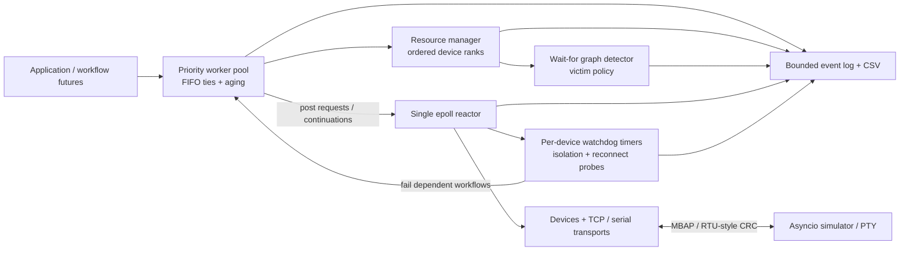

# MachineOrchestrator

A Linux C++17 device-orchestration engine using nonblocking POSIX transports,
level-triggered epoll and asynchronous workflows. Dependencies: the C++ standard
library, Linux system interfaces, Python's standard library for simulation/tools,
and GoogleTest (fetched with a pinned SHA256). Matplotlib is optional.

## Architecture



The reactor owns all device I/O and watchdog timers. Workers advance one workflow
step at a time and resume from callbacks; they never wait for device I/O. Delay
steps use timers. Level-triggered epoll makes partial I/O and would-block handling
straightforward; it does not require every callback to drain an edge completely.
Artificial transport stalls explicitly disarm fd readiness and use a reactor timer.

Lock hierarchy: Engine coordination -> ResourceManager -> DeadlockDetector.
EventLog is a leaf sink; scheduler queue locks never execute callbacks. Resource
wakeups run outside resource locking and enqueue continuations. Audit sinks run
under the log lock and must not reenter Engine or EventLog.

Production workflows acquire their whole declared device set in ascending ID
order and retain it until completion, failure or abort. Rank inversions are errors.
The graph detector adds defense in depth; UNCHECKED/manual acquisitions are solely
for tests and the deadlock demo. A cycle aborts its lowest-priority member, breaking
ties by youngest submission, and releases its resources. `VictimPolicy` is replaceable.

Watchdogs distinguish local argument rejection and live Modbus exceptions from
transport failures. Consecutive failures move Healthy -> Suspect -> Faulted.
Fail-fast isolation completes affected workflows with DeviceFaulted and frees their
other resources. Reconnect/probe attempts use capped exponential backoff through
Recovering; a successful probe restores Healthy. With fail-fast disabled, existing
workflows fail at their next dispatch or affected I/O completion.

## Build and run

Install a C++17 compiler, CMake >= 3.16, and Python 3. In the managed development
image, `source scripts/dev-env.sh` activates the locally installed CMake.

```sh
cmake -S . -B build
cmake --build build -j2
ctest --test-dir build --output-on-failure --parallel 1
```

Tests individually appear in CTest and carry `unit`, `integration`, `fault`, and/or
`stress` labels. Simulator fixtures share an advisory port lease across processes
and use ports below Linux's default ephemeral range. Keep CTest serial for stable,
comparable verification times. No physical device is needed.

Start a simulator in one terminal, then run the orchestrator in another:

```sh
python3 sim/device_sim.py --tcp-count 40 --base-port 15020 --control-port 15019
./build/mo_orchestrator_demo --devices 40 --base-port 15020
./build/mo_orchestrator_demo --unchecked-deadlock-demo
./build/mo_orchestrator_demo --kill-device 0 --control-port 15019
```

Restart/reset the simulator after the silence demo. The original `mo_demo` is also
available; `python3 scripts/run_demo.py` manages a temporary simulator for it.
Serial simulation: `python3 sim/device_sim.py --serial` prints its PTY path.

```cpp
mo::Engine engine;
engine.addDevice(0, {"127.0.0.1", 15020, {}, 115200});
engine.start();
mo::Workflow workflow;
workflow.named("set-and-check").withPriority(5).needs({0})
    .then(mo::WriteRegister{0, 10, 42})
    .then(mo::ReadRegisters{0, 10, 1, "value"});
auto handle = engine.submit(workflow);
auto result = handle.completion.get(); // application thread, never a worker
engine.stop();
```

Configure workers, aging, request deadlines, watchdog thresholds/backoff/probe
registers and event capacity through `EngineConfig`. Add devices before start;
submit from any thread after start returns. Lifecycle start/stop belongs to one
external owner. Stop aborts outstanding workflows, cancels requests/timers, drains
continuations and joins threads. Keep a Reactor alive longer than standalone Devices;
Device callbacks must not block or throw.

## Fault injection and verification

`tests/fault_transport.hpp` provides a runtime-configurable atomic `FaultPlan` and
`FaultyTransport` decorator. `EngineConfig::transportFactory(id, endpoint)` injects
it without changing orchestration logic. Faults cover send loss, receive truncation,
corruption, delayed receive, resets, failed open and timer-backed EAGAIN storms.
The simulator's optional loopback control port accepts one newline-terminated
command per connection, replying OK or ERROR:

- `silence ID`, `resume ID`, `hold ID` (gate a response without a timing race).
- `delay ID ms`, `garbage ID`, `partial ID`, `wrong-tx ID`, `exception ID code`.
- `drop ID` closes current connections; `reset ID` clears control faults/registers and
  closes connections. CLI `--fault` flags remain available.

The scripted scenarios use futures, condition variables and event gates. A shared
configuration header holds timing margins; each fixture has a global deadline.
Every scenario checks all submitted workflow futures, resource release, a healthy
independent device, monotonic events, balanced locks and terminal command outcomes.
An audit sink sees the full stream even when testing drop-oldest ring overflow.

```sh
scripts/run_sanitizers.sh --repeat 10
scripts/run_bug_injection.sh
ctest --test-dir build -L fault --output-on-failure
```

Sanitizer automation builds normal, ASAN+UBSAN and TSan separately, runs the full
suite in each, then repeats every fault/integration/stress test under TSan. It sets
`TSAN_OPTIONS=halt_on_error=1:second_deadlock_stack=1`. No suppressions are used.
A nonzero exit indicates a failed build/test. Complete logs are in the ignored
`build-verification-logs/`; JSON evidence is saved under `verification/`.

`-DMO_INJECT_BUG=name` deliberately mutates one production translation unit. It
must never be set in a production build. Ordinary builds compile mutation checks
away. The mutation runner reuses separate normal/TSan build trees, selects an
existing invariant test and records its failed CTest name. A build error is an
infrastructure error, never a caught bug. Race mutations run under TSan; the test
suite itself has no conditional assertions for mutations. See `scripts/bugs.json`.

<!-- RUN_RESULTS -->

Measured verification results ([JSON evidence](verification/sanitizers.json)):

| Build | CTest tests | Fault scenarios | Result |
|---|---:|---:|---|
| normal | 81 | 50 | PASS |
| asan-ubsan | 81 | 50 | PASS |
| tsan | 81 | 50 | PASS |

Additional TSan repeat pass: 62 selected tests × 10 executions = 620 passes, including every fault scenario in each repetition.

No sanitizer suppressions are used. Analyzer arithmetic and dropped-event warning checks also run with `python3 tests/test_latency_analysis.py`.

Scenario-exposed production bugs identified: **0**. The initial verification failure was a simulator port collision; its record is retained in [history](verification/history/initial_sanitizers.json). Test hardening fixed the port lease and acquisition gate; production changes are the documented injection/measurement hooks and deliberate mutations.

Mutation proof: **16/16 caught**, from [actual runner output](verification/bug_injection.json).

| Mutation | Result | Test that failed |
|---|---|---|
| `unlocked_log` | caught | Regression.ConcurrentLog |
| `unlocked_queue` | caught | Regression.ConcurrentQueue |
| `lock_order` | caught | Resources.OrderedContentionViolationAndIdempotentRelease |
| `missing_abort_release` | caught | FaultScenarios.AbortInFlight |
| `lost_wakeup` | caught | Resources.OrderedContentionViolationAndIdempotentRelease |
| `wrong_priority` | caught | Scheduler.PriorityAndFifo |
| `aging_disabled` | caught | Scheduler.AgingBeatsNewHighPriorityWork |
| `missing_cycle_edge` | caught | Deadlock.TwoWorkflowCycleAndLowestPriority |
| `watchdog_disabled` | caught | Watchdog.IsolationOtherDevicesAndRecovery |
| `timeout_off_by_one` | caught | Regression.TimeoutTargetsRequest |
| `transaction_mismatch` | caught | FaultScenarios.WrongTransactionId |
| `crc_skipped` | caught | Codec.StreamingAndErrors |
| `double_release` | caught | Regression.RepeatedReleasePreservesNewOwner |
| `callback_after_complete` | caught | Regression.CallbackExactlyOnce |
| `missing_release_event` | caught | Regression.ReleaseExactlyOnce |
| `drop_counter` | caught | Regression.DroppedEventCount |

<!-- END_RUN_RESULTS -->

## Latency measurement

Command latency is **command_submitted -> response_received**, matched by the
globally unique nonzero `command_id` (and device ID). Submission is recorded when
Device accepts a valid request; this includes its output queue and I/O time but
excludes scheduler/resource waiting before dispatch. Sent means the entire frame
was written. `command_timeout`/`command_failed` outcomes are counted separately and excluded
from latency samples. Modbus exception replies count as received frames; the
benchmark issues valid reads. Jitter is population standard deviation. Percentiles use linear
interpolation at index `(n - 1) * p` in sorted samples.

The CSV columns are
`timestamp_ns,type,workflow_id,device_id,command_id,detail`; timestamps are steady
clock nanoseconds. Comment metadata reports dropped events and actual realtime
policy outcomes. `Engine::events().snapshot()` gives structured events;
`dumpCsv(stream)` exports them and `dropped()` reports lost oldest events.
Overflow biases analysis, so the analyzer explicitly warns when drops are nonzero.
Export after `Engine::stop()` for a complete stream; a live snapshot may contain
in-flight commands.

```sh
scripts/run_latency_comparison.sh --devices 40 --workflows 500 --duration 1
python3 scripts/analyze_latency.py verification/latency/normal.csv \
  --report report.txt --series timeseries.csv --png latency.png
```

The comparison script builds the benchmark, runs a fresh zero-latency/jitter
simulator per mode, prints reports side by side and preserves CSV/JSON, text,
time-series and optional PNG artifacts. `mo_bench_latency` also accepts
`--base-port`, `--event-capacity`, `--csv`, and `--fifo`; workflow count is the batch
size and duration controls repeated batches (zero duration runs one batch).
Matplotlib absence skips plotting gracefully; all analysis remains standard library.
Actual SCHED_FIFO grants/fallbacks are reported for every worker and the reactor.
The saved runs use the default CMake configuration without an explicit optimized
build type.

<!-- LATENCY_RESULTS -->

Measured results ([raw CSV and reports](verification/latency/)):

| Requested mode | Samples | Mean ms | p50 ms | p95 ms | p99 ms | Max ms | Jitter ms |
|---|---:|---:|---:|---:|---:|---:|---:|
| normal | 3500 | 1.469284 | 0.663580 | 5.698986 | 11.194535 | 15.312282 | 2.129759 |
| fifo | 4000 | 2.050289 | 1.283640 | 6.671630 | 12.337615 | 16.222809 | 2.420665 |

- normal: realtime_requested=0 granted=0 fallback=0; dropped_events=0; failed commands=0, unfinished=0, unmatched outcomes=0.
- fifo: realtime_requested=1 granted=0 fallback=5; dropped_events=0; failed commands=0, unfinished=0, unmatched outcomes=0.

The FIFO result must be interpreted using the recorded grant/fallback counts, not the requested flag alone.

<!-- END_LATENCY_RESULTS -->

The simulator and engine share this machine. These results measure the software
setup, local kernel scheduling and host load, not hardware or a real-time latency
guarantee. When SCHED_FIFO is denied, both runs use normal scheduling; differences
are run-to-run variation and cannot establish a realtime-policy advantage.

## Known limitations

- Engine instances are single-use; create a fresh Engine for another run.
- Issued writes cannot be rolled back; aborting a workflow is not a transaction.
- Numeric IPv4 endpoints only; no DNS/IPv6 transport support.
- Serial is raw 8N1 with CRC framing, without RTU silent-interval enforcement.
- Verification uses loopback/PTY simulation, not physical hardware.
- Resource ownership spans the entire workflow, including Delay steps; there is
  no priority inheritance. Aging helps runnable work, not a parked lock holder.
- Completed workflow contexts are retained until Engine destruction. Event log
  retention is bounded and drops oldest records, with a counter.
- TCP transaction IDs wrap; peers must not retain replies across an ID reuse cycle.
