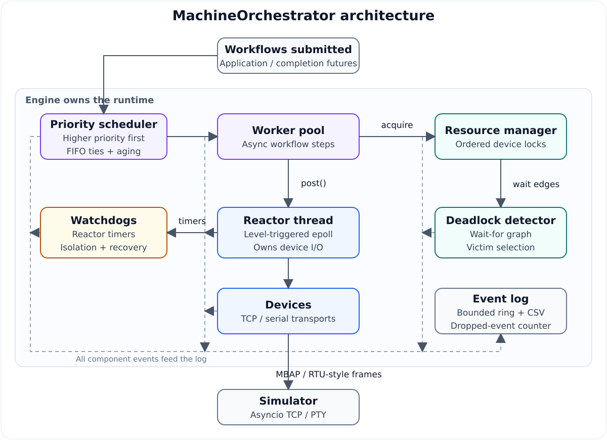
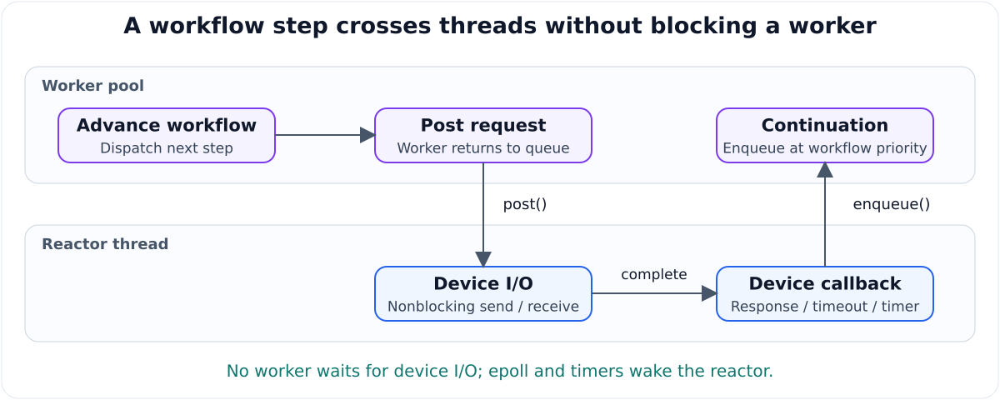
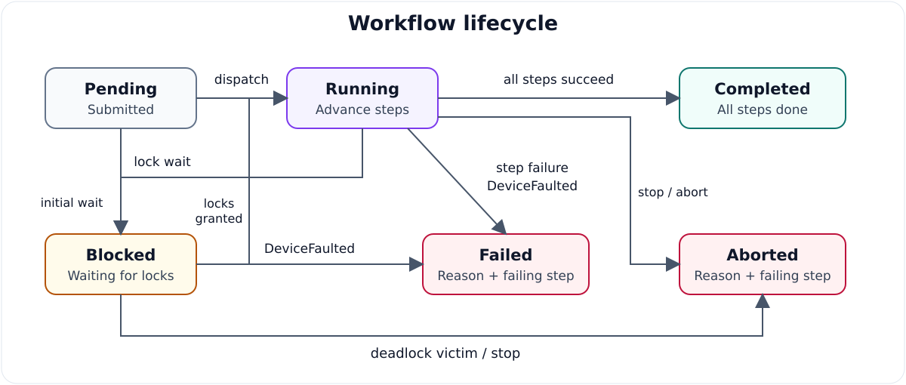
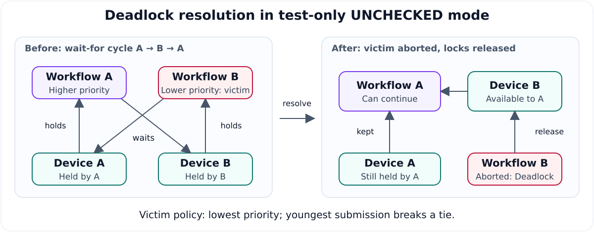
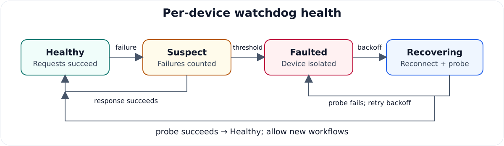
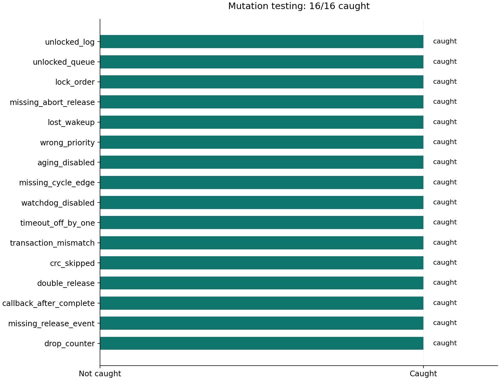
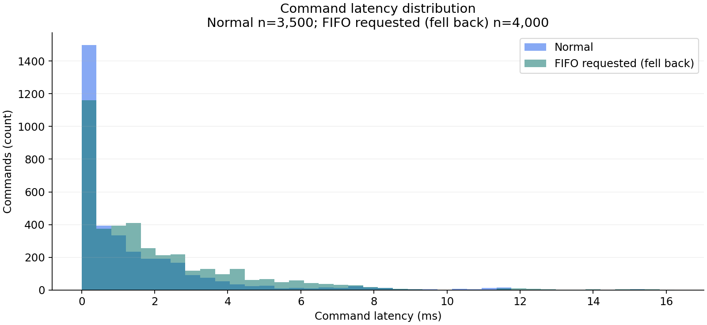
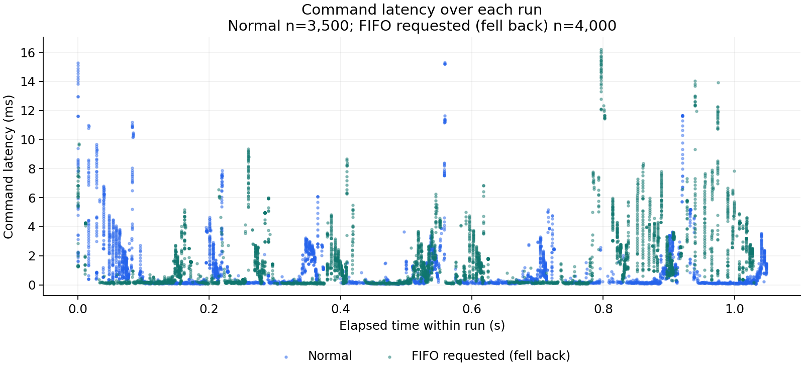

# MachineOrchestrator

**Asynchronous device orchestration for Linux, built with C++17.**

   

## What it is

MachineOrchestrator coordinates register-based devices through asynchronous workflows.
One reactor owns device I/O while a priority worker pool advances workflow steps.
Ordered locks protect shared devices, and watchdogs isolate failures and probe for recovery.
It is verified against local TCP and PTY simulators; physical hardware is not yet verified.



## Key features

- Modbus-style TCP and RTU framing with reads, writes, exceptions and CRC validation.
- Nonblocking TCP/serial transports driven by a level-triggered epoll reactor.
- Builder-style workflows with reads, writes, timer delays and conditional steps.
- Priority scheduling with FIFO ties, configurable aging and optional SCHED_FIFO.
- Ordered device locking plus a wait-for graph detector and replaceable victim policy.
- Per-device health tracking, fail-fast isolation and reconnect/probe backoff.
- Bounded monotonic event recording, CSV export and dropped-event accounting.
- Runtime fault injection, sanitizer automation and deliberate mutation testing.

## Results at a glance

<!-- RUN_RESULTS -->

| Verified result | Observation |
|---|---|
| Simulated devices | 41 in the workflow stress test |
| Concurrent workflows | 100 in that stress test |
| Fault scenarios | 50, individually registered in CTest |
| CTest tests | 81 passing in each build configuration |
| Injected bugs caught | 16 / 16 |
| Normal latency p50 / p95 / p99 | 0.663580 / 5.698986 / 11.194535 ms |
| Sanitizers | ASAN+UBSAN and TSan pass; no reports or suppressions |

<!-- END_RUN_RESULTS -->

Sources: [verification evidence](docs/VERIFICATION.md) and [latency results](docs/LATENCY.md).
Badges summarize the committed verification run; they are static, not live CI status.

## Quick start

Requires Linux, a C++17 compiler, CMake ≥ 3.16 and Python 3.
GoogleTest is fetched with a pinned SHA256; matplotlib is optional for charts.
In the managed cloud image, first run `source scripts/dev-env.sh` to activate CMake.

Build:

```sh
cmake -S . -B build
cmake --build build -j2
```

Run tests:

```sh
ctest --test-dir build --output-on-failure --parallel 1
```

Run the simulator in one terminal and the demo in another:

```sh
python3 sim/device_sim.py --tcp-count 40 --base-port 15020 --control-port 15019
# In another terminal:
./build/mo_orchestrator_demo --devices 40 --base-port 15020
```

The demo submits 100 workflows with overlapping device sets and mixed priorities.
For serial mode, fault controls and failure demos, see [protocol and simulator](docs/PROTOCOL_AND_SIMULATOR.md).

## How it works

**Reactor.** One thread owns transports, fd readiness and timers; I/O stays nonblocking.
Level-triggered epoll simplifies partial transfers. [Thread ownership](docs/DESIGN.md#who-calls-what).

**Workflows and scheduler.** Workers dispatch a step and return to the queue while I/O runs.
Callbacks enqueue continuations; aging helps low-priority runnable work. [Workflow lifecycle](docs/DESIGN.md#workflow-lifecycle).

**Locking and deadlocks.** Production workflows acquire devices in rank order.
The detector resolves test-mode cycles by aborting the lowest-priority victim (youngest on a tie). [Locking policy](docs/DESIGN.md#ordered-locking-and-deadlock-resolution).

**Watchdogs.** Consecutive failures isolate a device and release dependent workflow resources.
Reconnect probes restore availability after success. [Health and recovery](docs/DESIGN.md#device-health-and-recovery).

<details>
<summary>Explore the threading, lifecycle, deadlock and watchdog diagrams</summary>









</details>

## Verification summary

- All 81 CTest tests pass normally, with ASAN+UBSAN, and with TSan.
- The additional repeat run passed 620 executions: 62 selected tests repeated ten times.
- Every fault scenario checks terminal futures, released locks, independent-device health and event pairing.
- All 16 deliberate mutations were caught by unchanged invariant assertions; race mutations ran under TSan.
- No pre-existing production bug was identified; acquisition-gating and port-collision issues in the test harness were fixed.
- See the [scenario list, failing mutation-test names and reproducibility steps](docs/VERIFICATION.md).



## Latency summary

Latency is `command_submitted → response_received`, matched by command ID.
Jitter is the population standard deviation; definitions and the complete table are in [latency details](docs/LATENCY.md).

<!-- LATENCY_RESULTS -->

| Requested mode | Samples | p50 ms | p95 ms | p99 ms |
|---|---:|---:|---:|---:|
| Normal | 3,500 | 0.663580 | 5.698986 | 11.194535 |
| FIFO requested | 4,000 | 1.283640 | 6.671630 | 12.337615 |

<!-- END_LATENCY_RESULTS -->

These are local simulator measurements; SCHED_FIFO was denied for all five requested threads, so both runs used normal scheduling.





Regenerate the documentation visuals without taking new measurements:

```sh
python3 scripts/make_docs_visuals.py
```

Raw CSV, per-device reports and the original plots remain in [verification/latency/](verification/latency/).

## Project layout

```text
include/mo/       Public engine, device, protocol and coordination APIs
src/              Implementations, demos and latency benchmark
sim/              Asyncio TCP and PTY simulator
tests/           Unit, integration, fault and stress tests
scripts/          Build verification, analysis and documentation tools
docs/             Design, verification, latency and protocol guides
  images/         Generated SVG diagrams and PNG data charts
verification/     Committed measurements and verification evidence
```

## Known limitations

- Engine instances are single-use; issued writes cannot be rolled back.
- TCP endpoints use numeric IPv4; serial has no RTU silent-interval enforcement.
- Verification is simulator-based, without physical-hardware validation.
- Locks span entire workflows, including delays; there is no priority inheritance.
- Completed contexts stay until Engine destruction; bounded logs drop oldest events.
- TCP transaction IDs wrap; peers must not retain replies across an ID reuse cycle.

See [design and limitations](docs/DESIGN.md#known-limitations) for the full context.
