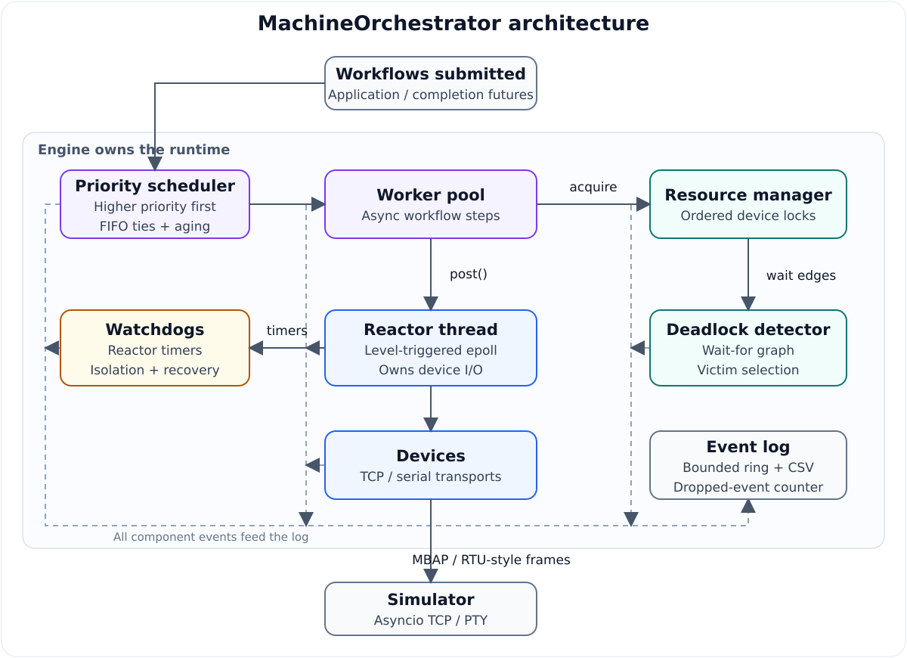
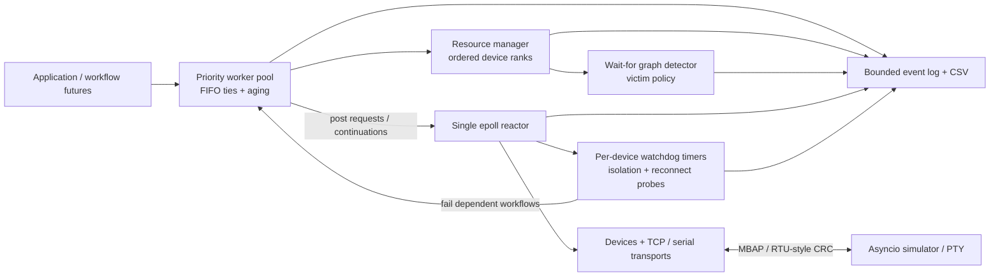
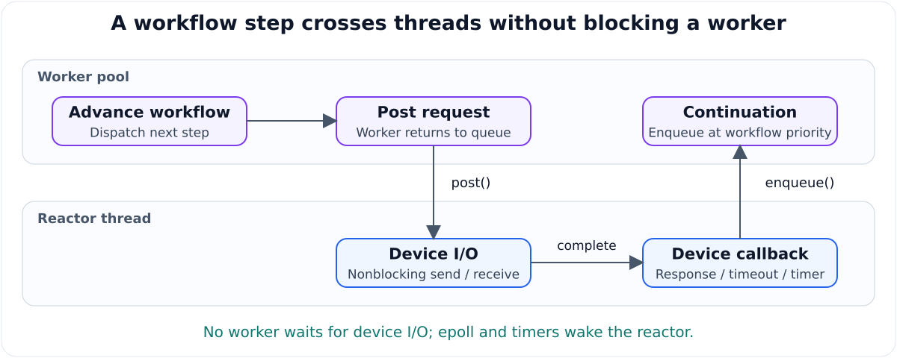
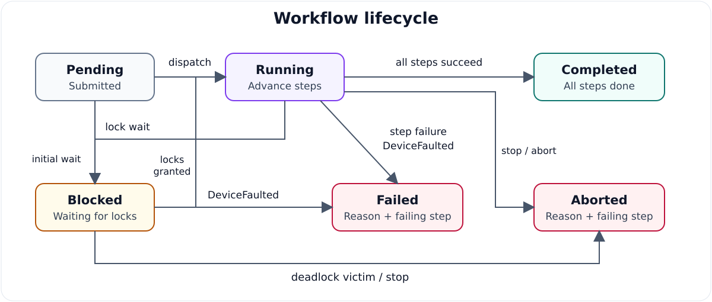
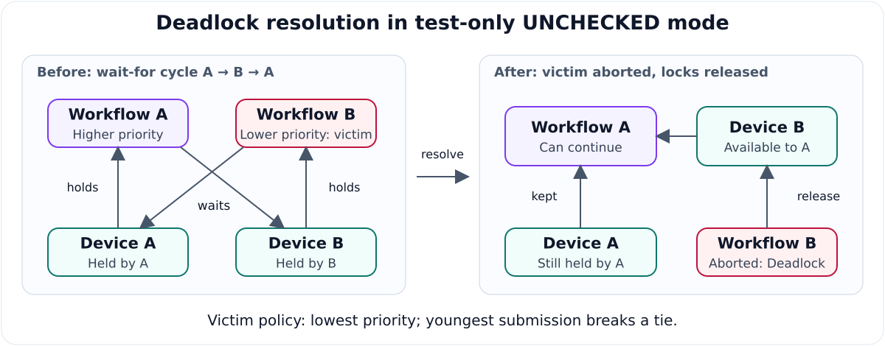
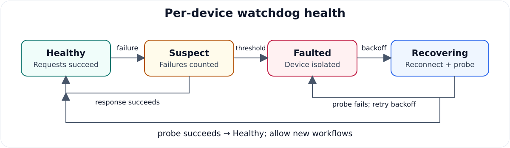

# Design and runtime ownership

[README](../README.md) · [Design](DESIGN.md) · [Verification](VERIFICATION.md) · [Latency](LATENCY.md) · [Protocol and simulator](PROTOCOL_AND_SIMULATOR.md)

A Linux C++17 device-orchestration engine using nonblocking POSIX transports,
level-triggered epoll and asynchronous workflows. Dependencies: the C++ standard
library, Linux system interfaces, Python's standard library for simulation/tools,
and GoogleTest (fetched with a pinned SHA256). Matplotlib is optional.

## Architecture and decisions





The reactor owns all device I/O and watchdog timers. Workers advance one workflow
step at a time and resume from callbacks; they never wait for device I/O. Delay
steps use timers. Level-triggered epoll makes partial I/O and would-block handling
straightforward; it does not require every callback to drain an edge completely.
Artificial transport stalls explicitly disarm fd readiness and use a reactor timer.

Lock hierarchy: Engine coordination -> ResourceManager -> DeadlockDetector.
EventLog is a leaf sink; scheduler queue locks never execute callbacks. Resource
wakeups run outside resource locking and enqueue continuations. Audit sinks run
under the log lock and must not reenter Engine or EventLog.

Production workflows acquire their whole declared device set in ascending ID
order and retain it until completion, failure or abort. Rank inversions are errors.
The graph detector adds defense in depth; UNCHECKED/manual acquisitions are solely
for tests and the deadlock demo. A cycle aborts its lowest-priority member, breaking
ties by youngest submission, and releases its resources. `VictimPolicy` is replaceable.

Watchdogs distinguish local argument rejection and live Modbus exceptions from
transport failures. Consecutive failures move Healthy -> Suspect -> Faulted.
Fail-fast isolation completes affected workflows with DeviceFaulted and frees their
other resources. Reconnect/probe attempts use capped exponential backoff through
Recovering; a successful probe restores Healthy. With fail-fast disabled, existing
workflows fail at their next dispatch or affected I/O completion.

## Who calls what

| Caller | Allowed work | Ownership / constraint |
|---|---|---|
| Application owner | Add devices, start and stop Engine | Add devices before start; lifecycle has one external owner. |
| Application threads | Submit workflows and wait for completion futures | Submit after start returns; never wait from a worker or reactor callback. |
| Scheduler workers | Dispatch a workflow step; enqueue another runnable continuation | No blocking device I/O, no mutex held across I/O. |
| Reactor thread | Device/Transport I/O, fd watches, timers and watchdog transitions | External callers marshal work through `Reactor::post`. |
| Resource wake callback | Make a parked workflow runnable | Called outside the resource mutex; only enqueues scheduler work. |
| Event audit sink | Observe structured events | Called under the log mutex; must not reenter Engine or EventLog. |



## Workflow lifecycle

A workflow declares devices, a priority, and a sequence of write, read, Delay,
Conditional or test-only manual-acquisition steps. Read results live in its own
variable map. Completion futures include the terminal state, failing step, reason
and variables. Blocked means waiting for resources; waiting for an asynchronous
response or timer retains Running state.



## Ordered locking and deadlock resolution

Acquiring the declared set in increasing device rank prevents a circular wait.
The engine retains resources through the complete workflow, including Delay.
The detector still records blocking edges; UNCHECKED mode permits real cycles
for testing. Detection runs on a newly blocked edge. Aborting the selected victim
releases its resources and makes affected waiters runnable.



## Device health and recovery

Watchdogs run on reactor timers rather than dedicated threads. Local request
validation errors do not count as device failures; Modbus exception replies prove
that the device is alive. Isolation stops device traffic and, in fail-fast mode,
fails every dependent workflow. Recovery probes re-open the existing endpoint;
a successful probe re-enables submissions that need that device.



## Using the Engine

```cpp
mo::Engine engine;
engine.addDevice(0, {"127.0.0.1", 15020, {}, 115200});
engine.start();
mo::Workflow workflow;
workflow.named("set-and-check").withPriority(5).needs({0})
    .then(mo::WriteRegister{0, 10, 42})
    .then(mo::ReadRegisters{0, 10, 1, "value"});
auto handle = engine.submit(workflow);
auto result = handle.completion.get(); // application thread, never a worker
engine.stop();
```

Configure workers, aging, request deadlines, watchdog thresholds/backoff/probe
registers and event capacity through `EngineConfig`. Add devices before start;
submit from any thread after start returns. Lifecycle start/stop belongs to one
external owner. Stop aborts outstanding workflows, cancels requests/timers, drains
continuations and joins threads. Keep a Reactor alive longer than standalone Devices;
Device callbacks must not block or throw.

The public interfaces are in [include/mo/](../include/mo/). Standalone Device
usage and the protocol/transport contracts remain available below Engine.

## Known limitations

- Engine instances are single-use; create a fresh Engine for another run.
- Issued writes cannot be rolled back; aborting a workflow is not a transaction.
- Numeric IPv4 endpoints only; no DNS/IPv6 transport support.
- Serial is raw 8N1 with CRC framing, without RTU silent-interval enforcement.
- Verification uses loopback/PTY simulation, not physical hardware.
- Resource ownership spans the entire workflow, including Delay steps; there is
  no priority inheritance. Aging helps runnable work, not a parked lock holder.
- Completed workflow contexts are retained until Engine destruction. Event log
  retention is bounded and drops oldest records, with a counter.
- TCP transaction IDs wrap; peers must not retain replies across an ID reuse cycle.
