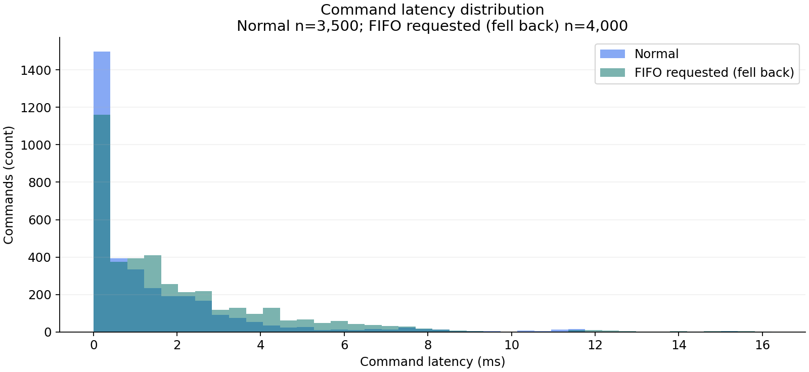
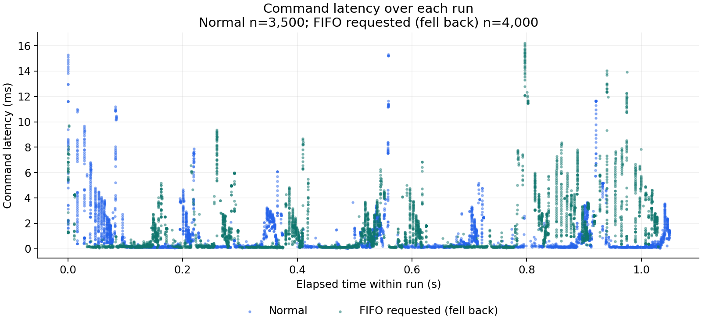

# Latency definitions, method and results

[README](../README.md) · [Design](DESIGN.md) · [Verification](VERIFICATION.md) · [Latency](LATENCY.md) · [Protocol and simulator](PROTOCOL_AND_SIMULATOR.md)

Command latency is **command_submitted -> response_received**, matched by the
globally unique nonzero `command_id` (and device ID). Submission is recorded when
Device accepts a valid request; this includes its output queue and I/O time but
excludes scheduler/resource waiting before dispatch. Sent means the entire frame
was written. `command_timeout`/`command_failed` outcomes are counted separately and excluded
from latency samples. Modbus exception replies count as received frames; the
benchmark issues valid reads. Jitter is population standard deviation. Percentiles use linear
interpolation at index `(n - 1) * p` in sorted samples.

The CSV columns are
`timestamp_ns,type,workflow_id,device_id,command_id,detail`; timestamps are steady
clock nanoseconds. Comment metadata reports dropped events and actual realtime
policy outcomes. `Engine::events().snapshot()` gives structured events;
`dumpCsv(stream)` exports them and `dropped()` reports lost oldest events.
Overflow biases analysis, so the analyzer explicitly warns when drops are nonzero.
Export after `Engine::stop()` for a complete stream; a live snapshot may contain
in-flight commands.

```sh
scripts/run_latency_comparison.sh --devices 40 --workflows 500 --duration 1
python3 scripts/analyze_latency.py verification/latency/normal.csv \
  --report report.txt --series timeseries.csv --png latency.png
```

The comparison script builds the benchmark, runs a fresh zero-latency/jitter
simulator per mode, prints reports side by side and preserves CSV/JSON, text,
time-series and optional PNG artifacts. `mo_bench_latency` also accepts
`--base-port`, `--event-capacity`, `--csv`, and `--fifo`; workflow count is the batch
size and duration controls repeated batches (zero duration runs one batch).
Matplotlib absence skips plotting gracefully; all analysis remains standard library.
Actual SCHED_FIFO grants/fallbacks are reported for every worker and the reactor.
The saved runs use the default CMake configuration without an explicit optimized
build type.

<!-- LATENCY_RESULTS -->

Measured results ([raw CSV and reports](../verification/latency/)):

| Requested mode | Samples | Mean ms | p50 ms | p95 ms | p99 ms | Max ms | Jitter ms |
|---|---:|---:|---:|---:|---:|---:|---:|
| normal | 3500 | 1.469284 | 0.663580 | 5.698986 | 11.194535 | 15.312282 | 2.129759 |
| fifo | 4000 | 2.050289 | 1.283640 | 6.671630 | 12.337615 | 16.222809 | 2.420665 |

- normal: realtime_requested=0 granted=0 fallback=0; dropped_events=0; failed commands=0, unfinished=0, unmatched outcomes=0.
- fifo: realtime_requested=1 granted=0 fallback=5; dropped_events=0; failed commands=0, unfinished=0, unmatched outcomes=0.

The FIFO result must be interpreted using the recorded grant/fallback counts, not the requested flag alone.

<!-- END_LATENCY_RESULTS -->

The simulator and engine share this machine. These results measure the software
setup, local kernel scheduling and host load, not hardware or a real-time latency
guarantee. When SCHED_FIFO is denied, both runs use normal scheduling; differences
are run-to-run variation and cannot establish a realtime-policy advantage.

## Distribution and time series





Each time series starts at its own run's first submitted command. The plots do not
align independent runs to a common wall clock or imply that a realtime policy was
granted. Both measured runs used normal scheduling.

Per-device summaries and text histograms are preserved in the
[normal report](../verification/latency/normal.txt) and
[FIFO-requested report](../verification/latency/fifo.txt). Raw events, time-series
CSV, structured summaries and the earlier combined plots remain in
[verification/latency/](../verification/latency/).

## Regenerating documentation charts

```sh
python3 scripts/make_docs_visuals.py
```

This reads existing CSV and JSON; it does not take new measurements. Matplotlib
produces PNG data charts. Without it, the script reports the missing optional
dependency and writes SVG chart fallbacks. The block diagrams use only the Python
standard library and are always SVG.
