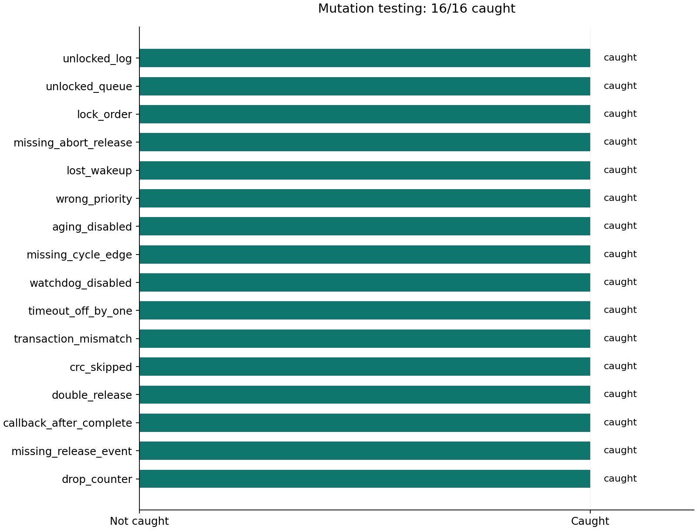

# Verification and fault scenarios

[README](../README.md) · [Design](DESIGN.md) · [Verification](VERIFICATION.md) · [Latency](LATENCY.md) · [Protocol and simulator](PROTOCOL_AND_SIMULATOR.md)

## Build and test

Install a C++17 compiler, CMake >= 3.16, and Python 3. In the managed development
image, `source scripts/dev-env.sh` activates the locally installed CMake.

```sh
cmake -S . -B build
cmake --build build -j2
ctest --test-dir build --output-on-failure --parallel 1
```

Tests individually appear in CTest and carry `unit`, `integration`, `fault`, and/or
`stress` labels. Simulator fixtures share an advisory port lease across processes
and use ports below Linux's default ephemeral range. Keep CTest serial for stable,
comparable verification times. No physical device is needed.

## Client-side injection

`tests/fault_transport.hpp` provides a runtime-configurable atomic `FaultPlan` and
`FaultyTransport` decorator. `EngineConfig::transportFactory(id, endpoint)` injects
it without changing orchestration logic. Faults cover send loss, receive truncation,
corruption, delayed receive, resets, failed open and timer-backed EAGAIN storms.

## Shared scenario invariants

The scripted scenarios use futures, condition variables and event gates. A shared
configuration header holds timing margins; each fixture has a global deadline.
Every scenario checks all submitted workflow futures, resource release, a healthy
independent device, monotonic events, balanced locks and terminal command outcomes.
An audit sink sees the full stream even when testing drop-oldest ring overflow.

```sh
scripts/run_sanitizers.sh --repeat 10
scripts/run_bug_injection.sh
ctest --test-dir build -L fault --output-on-failure
```

Sanitizer automation builds normal, ASAN+UBSAN and TSan separately, runs the full
suite in each, then repeats every fault/integration/stress test under TSan. It sets
`TSAN_OPTIONS=halt_on_error=1:second_deadlock_stack=1`. No suppressions are used.
A nonzero exit indicates a failed build/test. Complete logs are in the ignored
`build-verification-logs/`; JSON evidence is saved under `verification/`.

`-DMO_INJECT_BUG=name` deliberately mutates one production translation unit. It
must never be set in a production build. Ordinary builds compile mutation checks
away. The mutation runner reuses separate normal/TSan build trees, selects an
existing invariant test and records its failed CTest name. A build error is an
infrastructure error, never a caught bug. Race mutations run under TSan; the test
suite itself has no conditional assertions for mutations. See `scripts/bugs.json`.

<!-- RUN_RESULTS -->

Measured verification results ([JSON evidence](../verification/sanitizers.json)):

| Build | CTest tests | Fault scenarios | Result |
|---|---:|---:|---|
| normal | 81 | 50 | PASS |
| asan-ubsan | 81 | 50 | PASS |
| tsan | 81 | 50 | PASS |

Additional TSan repeat pass: 62 selected tests × 10 executions = 620 passes, including every fault scenario in each repetition.

No sanitizer suppressions are used. Analyzer arithmetic and dropped-event warning checks also run with `python3 tests/test_latency_analysis.py`.

Scenario-exposed production bugs identified: **0**. The initial verification failure was a simulator port collision; its record is retained in [history](../verification/history/initial_sanitizers.json). Test hardening fixed the port lease and acquisition gate; production changes are the documented injection/measurement hooks and deliberate mutations.

Mutation proof: **16/16 caught**, from [actual runner output](../verification/bug_injection.json).

| Mutation | Result | Test that failed |
|---|---|---|
| `unlocked_log` | caught | Regression.ConcurrentLog |
| `unlocked_queue` | caught | Regression.ConcurrentQueue |
| `lock_order` | caught | Resources.OrderedContentionViolationAndIdempotentRelease |
| `missing_abort_release` | caught | FaultScenarios.AbortInFlight |
| `lost_wakeup` | caught | Resources.OrderedContentionViolationAndIdempotentRelease |
| `wrong_priority` | caught | Scheduler.PriorityAndFifo |
| `aging_disabled` | caught | Scheduler.AgingBeatsNewHighPriorityWork |
| `missing_cycle_edge` | caught | Deadlock.TwoWorkflowCycleAndLowestPriority |
| `watchdog_disabled` | caught | Watchdog.IsolationOtherDevicesAndRecovery |
| `timeout_off_by_one` | caught | Regression.TimeoutTargetsRequest |
| `transaction_mismatch` | caught | FaultScenarios.WrongTransactionId |
| `crc_skipped` | caught | Codec.StreamingAndErrors |
| `double_release` | caught | Regression.RepeatedReleasePreservesNewOwner |
| `callback_after_complete` | caught | Regression.CallbackExactlyOnce |
| `missing_release_event` | caught | Regression.ReleaseExactlyOnce |
| `drop_counter` | caught | Regression.DroppedEventCount |

<!-- END_RUN_RESULTS -->

## Individually registered scenarios

These names are read from [tests/fault_scenarios.cpp](../tests/fault_scenarios.cpp)
and correspond to the fault label in the saved verification run. Every fixture
has a fresh simulator and single-use Engine. The independent device is checked
again after fault injection; global-stop cases use a completed pre-stop control.
Timing margins live in [tests/timing.hpp](../tests/timing.hpp).

```sh
ctest --test-dir build -N -L fault
ctest --test-dir build -L fault --output-on-failure --parallel 1
```

| # | CTest scenario | Area |
|---:|---|---|
| 1 | `FaultScenarios.SilentDevice` | Device and client transport faults |
| 2 | `FaultScenarios.SlowBelowTimeout` | Device and client transport faults |
| 3 | `FaultScenarios.SlowAboveTimeout` | Device and client transport faults |
| 4 | `FaultScenarios.GarbageResponse` | Device and client transport faults |
| 5 | `FaultScenarios.PartialFrameStall` | Device and client transport faults |
| 6 | `FaultScenarios.WrongTransactionId` | Device and client transport faults |
| 7 | `FaultScenarios.ExceptionIllegalAddress` | Device and client transport faults |
| 8 | `FaultScenarios.ExceptionBusy` | Device and client transport faults |
| 9 | `FaultScenarios.DropMidRequest` | Device and client transport faults |
| 10 | `FaultScenarios.DropDuringConnect` | Device and client transport faults |
| 11 | `FaultScenarios.FailOpen` | Device and client transport faults |
| 12 | `FaultScenarios.DeviceRecovers` | Device and client transport faults |
| 13 | `FaultScenarios.DeviceFlapsTwice` | Device and client transport faults |
| 14 | `FaultScenarios.ClientDropSend` | Device and client transport faults |
| 15 | `FaultScenarios.ClientCorruptReceive` | Device and client transport faults |
| 16 | `FaultScenarios.ClientTruncateReceive` | Device and client transport faults |
| 17 | `FaultScenarios.ClientDelayedReceiveSuccess` | Device and client transport faults |
| 18 | `FaultScenarios.ClientDelayedReceiveTimeout` | Device and client transport faults |
| 19 | `FaultScenarios.ForcedResetOnSend` | Device and client transport faults |
| 20 | `FaultScenarios.SendEagainStorm` | Device and client transport faults |
| 21 | `FaultScenarios.RecvEagainStorm` | Device and client transport faults |
| 22 | `FaultScenarios.CombinedWouldBlockAndDelay` | Device and client transport faults |
| 23 | `FaultScenarios.TwoWorkflowCycle` | Concurrency and shutdown |
| 24 | `FaultScenarios.ThreeWorkflowCycle` | Concurrency and shutdown |
| 25 | `FaultScenarios.DeadlockAndDeviceFault` | Concurrency and shutdown |
| 26 | `FaultScenarios.LockOrderViolation` | Concurrency and shutdown |
| 27 | `FaultScenarios.AbortWhileBlocked` | Concurrency and shutdown |
| 28 | `FaultScenarios.AbortInFlight` | Concurrency and shutdown |
| 29 | `FaultScenarios.SubmitDuringStop` | Concurrency and shutdown |
| 30 | `FaultScenarios.StopRunningWorkflows` | Concurrency and shutdown |
| 31 | `FaultScenarios.SuspectThreshold` | Watchdog and isolation |
| 32 | `FaultScenarios.FaultedRejectsImmediately` | Watchdog and isolation |
| 33 | `FaultScenarios.RecoveryBackoff` | Watchdog and isolation |
| 34 | `FaultScenarios.MultipleDevicesFault` | Watchdog and isolation |
| 35 | `FaultScenarios.FaultReleasesOtherResources` | Watchdog and isolation |
| 36 | `FaultScenarios.FaultWithQueuedWorkflows` | Watchdog and isolation |
| 37 | `FaultScenarios.ProbeExceptionThenRecovery` | Watchdog and isolation |
| 38 | `FaultScenarios.LocalRejectionDoesNotFaultDevice` | Watchdog and isolation |
| 39 | `FaultScenarios.PriorityInversionAttempt` | Scheduler and load |
| 40 | `FaultScenarios.AgingUnderNewHighPriorityLoad` | Scheduler and load |
| 41 | `FaultScenarios.FifoPressure` | Scheduler and load |
| 42 | `FaultScenarios.RealtimeUnavailableFallback` | Scheduler and load |
| 43 | `FaultScenarios.FloodFiveHundredWithFault` | Scheduler and load |
| 44 | `FaultScenarios.EventLogOverflow` | Resource and limits |
| 45 | `FaultScenarios.VeryLongWorkflow` | Resource and limits |
| 46 | `FaultScenarios.ZeroStepWorkflow` | Resource and limits |
| 47 | `FaultScenarios.DuplicateDeclaredDevices` | Resource and limits |
| 48 | `FaultScenarios.LateReplyAfterTimeout` | Late responses, reconnects and concurrent submissions |
| 49 | `FaultScenarios.ReconnectOpenFailures` | Late responses, reconnects and concurrent submissions |
| 50 | `FaultScenarios.ConcurrentSubmissionsWithFault` | Late responses, reconnects and concurrent submissions |



## Evidence and reproducibility

- [Sanitizer summary](../verification/sanitizers.json): full suite and TSan repetitions.
- [Mutation proof](../verification/bug_injection.json): caught/missed outcomes and failing test names.
- [Mutation catalog](../scripts/bugs.json): source file, test label and selected invariant for each mutation.
- [Phase findings](../verification/findings.json): production findings, test-hardening fixes and permitted hooks.
- [Initial run](../verification/history/initial_sanitizers.json) and
  [intermediate run](../verification/history/pre_final_sanitizers.json): retained history rather than discarded failures.

Run the existing scripts from the repository root. Their results are observations
from this machine, not guarantees of race freedom or real-hardware correctness.
